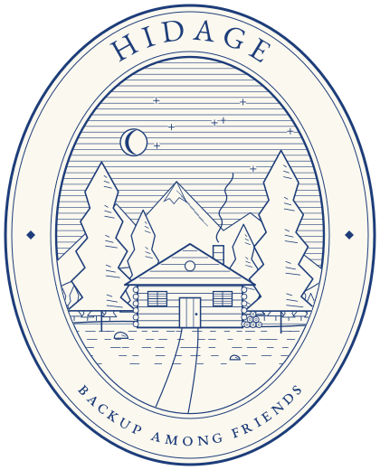

<p align="center"></p>

# hidage: encrypted backup with your friends

`hidage` backs up your folders to your friends' computers instead of a cloud service.
You keep their backups, they keep yours, each within the space you agree to give.
Everything is encrypted before it leaves your machine, so friends hold pieces they
cannot read. If your laptop dies, your 24-word recovery phrase and one friend's
contact card bring back your files, their history and your friend list.

> **Status: experimental.** Backup, pairing, recovery and audits work end to end and
> are tested, but the on-disk and network formats may still change. Don't make it the
> only copy of anything you can't afford to lose yet.

## Why hidage

- **No provider, no bill.** Storage is the spare disk you and your friends already
  have. Nobody else needs an account, a server or an open SSH port.
- **Friends can't read your data, and losing one doesn't lose it.** Each backup is
  encrypted, then erasure-coded into shards spread across your friends. With the
  default 2x redundancy, any half of the shards rebuild it.
- **You know it's still there.** The daemon regularly challenges friends to prove they
  still hold your shards, and `hidage status` tells you how many friends you could lose
  before a backup is at risk.
- **Real backups, not sync.** Every snapshot is versioned and deduplicated. Deleting or
  scrambling a file locally doesn't touch the versions your friends hold.

How it compares:

| | hidage | restic / borg + a friend's server | Syncthing | Tahoe-LAFS |
|---|---|---|---|---|
| Encrypted before it leaves | yes | yes | only to "untrusted" devices | yes |
| Versioned history | yes | yes | optional per-folder versioning | no (a filesystem) |
| Survives losing a host | yes, erasure-coded | one host per repository | if other devices have a copy | yes, erasure-coded |
| Checks hosts still hold it | yes, audits | by reading it all back | no | yes |
| Setup for the friend | one invite | an account, SSH, an open port | pairing | run a storage node, an introducer |

## Install

hidage runs on Linux, macOS and Windows 10/11, on x86-64 (amd64) and ARM (arm64).

> **The Windows binaries are untested on real machines.** They are cross-compiled
> and the unit tests pass on GitHub's Windows runners, but pairing, the firewall
> prompt, the scheduled task, the password store and a full backup and restore have
> not been tried on Windows yet. Please report what works and what doesn't.

Download the binary for your system from the
[releases page](https://github.com/gosub/hidage/releases), check it against
`SHA256SUMS`, and put it on your `PATH`:

```sh
curl -LO https://github.com/gosub/hidage/releases/latest/download/hidage-linux-amd64
chmod +x hidage-linux-amd64
mv hidage-linux-amd64 ~/.local/bin/hidage
hidage --version
```

The binaries are `hidage-linux-amd64`, `hidage-linux-arm64`, `hidage-darwin-amd64`
(Intel Mac), `hidage-darwin-arm64` (Apple silicon), `hidage-windows-amd64.exe` and
`hidage-windows-arm64.exe`. On macOS, a binary downloaded with a browser is
quarantined; clear it with `xattr -d com.apple.quarantine hidage`.

On Windows, in PowerShell:

```powershell
mkdir $env:LOCALAPPDATA\Programs\hidage -Force
curl.exe -Lo $env:LOCALAPPDATA\Programs\hidage\hidage.exe https://github.com/gosub/hidage/releases/latest/download/hidage-windows-amd64.exe
$env:Path += ";$env:LOCALAPPDATA\Programs\hidage"   # add it to Path in Settings to keep it
hidage --version
```

The `.exe` is not signed yet, so SmartScreen may warn the first time you run it, and
Windows Firewall asks whether to let hidage accept connections: allow it on private
networks so friends can reach you.

## Compile from source

You need Go 1.26 or newer:

```sh
git clone https://github.com/gosub/hidage.git && cd hidage
go install ./cmd/hidage          # into $(go env GOPATH)/bin; or: go build ./cmd/hidage
```

Releases are built by [`.github/workflows/release.yml`](.github/workflows/release.yml)
whenever a `vX.Y.Z` tag is pushed.

## Quick start

**You:**

```sh
hidage init                       # keyring, config.toml and data store; asks for a passphrase
hidage id --kit                   # your recovery kit: print it, keep it offline
hidage daemon --install           # install it as a login service (systemd, launchd or Task
                                  #   Scheduler), offer to save your passphrase in the
                                  #   OS password store, and print the command that starts it
hidage friend invite              # prints an invite: send it to a friend, privately
```

**Your friend** installs hidage and does the same `init` and `daemon --install`, then:

```sh
hidage friend add hidage1:ak6m…   # the invite you sent; you are now friends both ways
```

An invite works once and expires after 24 hours. If you're offline when your friend
adds it, their daemon retries until it reaches you.

**Back up a folder:**

```sh
hidage backup ~/Documents         # snapshot it, send it to your friends, and add it to
                                  #   the folders the daemon backs up every hour
hidage status                     # run inside the folder: is it protected, and how well?
```

**Let it run unattended.** The daemon needs your passphrase to take backups.
`hidage daemon --install` offers to save it in the OS password store: Windows
Credential Manager, the macOS Keychain, or the Secret Service on Linux (GNOME Keyring,
KWallet). Alternatively, set a command that prints it in `config.toml`:

```toml
passphrase_command = "pass show hidage"
# or: "systemd-creds decrypt ~/.config/hidage/pass.cred -"
```

Without either, the daemon runs *locked*: it keeps storing and relaying for your
friends, but takes no backups of yours, and `hidage status` says so.

Pair with at least two friends: with only one, losing them loses the backup, and
`hidage backup` warns about it.

## Getting files back

```sh
hidage restore --to ~/out                  # the latest snapshot of this folder
hidage log                                 # history, newest first
hidage restore 3f2a notes/todo.txt --to .  # one file from an older snapshot (id prefix)
hidage restore --friends --to ~/out        # fetch it from your friends instead
```

**On a new machine**, after losing the old one:

```sh
hidage init --recover                      # type or paste your 24-word phrase
hidage restore --friends --from hidage1:ahjp… --to ~/restored   # any one friend's card
```

This restores every folder you backed up, with its history, and your whole friend list
(stored encrypted inside your backup), so you only needed one card. Each restored
folder is a hidage repository again: `hidage backup` in it picks up where you left off
and only renews what your friends already hold.

## The nine commands

```sh
hidage init [--recover]           # set up this machine; --recover: from your phrase (stdin)
hidage id [--card | --kit]        # your key, addresses and contact card (no passphrase);
                                  #   --kit adds the recovery phrase and friends' cards
hidage friend invite              # single-use invite, valid 24h (--give, --name, --valid)
hidage friend add <invite|card>   # accept an invite (mutual) or add a contact card
hidage friend set bob --give 200GiB   # change a nickname or the space you give
hidage friend ls [-v]             # space both ways, last audit, last seen
hidage friend rm bob [--purge]    # remove (and delete what you hold for them)

hidage backup [folder]            # snapshot + send what changed to every reachable friend
                                  #   (--local: snapshot only; --once: don't schedule it)
hidage restore [snap] [path]      # --to, --list, --friends, --from <card>
hidage log                        # history, newest first, marking what friends hold
hidage log --diff a,b             # what changed between two snapshots
hidage log --friends              # every backup your friends hold for you
hidage forget <snap>...           # drop snapshots and free the space only they used
hidage status [--audit]           # freshness, friends' health, fault tolerance;
                                  #   non-zero exit when degraded
hidage daemon [--install]         # scheduled backups + store and relay for friends
```

Inside a backed-up folder, commands find its `.hidage/` by walking up from the current
directory, like git; elsewhere, pass `-C <dir>`. Snapshot ids can be shortened to any
unambiguous prefix, and `latest` names the newest. Run `hidage <command> --help` for
every flag.

Everything else is a setting in `config.toml` (see [Where things live](#where-things-live)),
which `init` writes with comments: the folders the daemon backs up and how often,
redundancy, the space you give friends by default, how long their data is kept, how
many old versions to keep, and network addresses.

## What happens to your data

1. **Snapshot.** Files are split into chunks at content-defined boundaries, so an edit
   only changes the chunks around it. Chunks are encrypted with a key derived from your
   recovery phrase and linked into a signed Merkle tree. An unchanged file costs
   nothing to snapshot again, and the same file in two folders is stored once.
2. **Pack and spread.** The encrypted objects are grouped into packs, and each pack is
   erasure-coded into shards that go to different friends. A later backup sends only
   the shards your friends don't already have.
3. **Keep and renew.** Each friend holds your shards within the space they give you.
   The daemon renews them daily; a backup nobody renews for 90 days is dropped. When a
   new backup replaces an old one, the old data stays in the friend's trash for 30
   days, so a compromised machine can't wipe your backups in one go.
4. **Audit.** The daemon asks each friend to prove they hold randomly chosen shards and
   records the result, which `hidage status` and `hidage friend ls` show.
5. **History.** By default friends keep your last 3 versions of each folder, plus one a
   day for a week and one a week for a month (`[retention]` in `config.toml`).

Friends find each other directly, with no public network involved. Behind a home
router, a node reaches its friends through a reachable friend's relay and then tries
to connect directly by hole punching.

For the key hierarchy, the encryption scheme, the formats and the garbage collector,
see [`DESIGN.md`](DESIGN.md). For what an attacker or a malicious friend can and can't
do, see [`THREAT_MODEL.md`](THREAT_MODEL.md).

## Where things live

| What | Linux and macOS | Windows |
|---|---|---|
| Settings | `~/.config/hidage/config.toml` | `%AppData%\hidage\config.toml` |
| Keyring: your root secret, wrapped under your passphrase | `~/.config/hidage/keyring.json` | `%AppData%\hidage\keyring.json` |
| Friend list | `~/.config/hidage/friends.json` | `%AppData%\hidage\friends.json` |
| File data, yours and your friends' | `~/.local/share/hidage/store` | `%LocalAppData%\hidage\store` |
| Daemon log | the journal (Linux), `~/Library/Logs/hidage.log` (macOS) | `%LocalAppData%\hidage\daemon.log` |

Each backed-up folder also gets a `.hidage/` directory with its history and metadata,
which travels with the folder like `.git`.

Put the store on a roomy disk with `store` in `config.toml` or `HIDAGE_STORE`, and
exclude it from other backups. It must be on a single filesystem that supports hard
links, which is how identical chunks are shared across folders: NTFS, APFS, ext4 and
most others do, FAT32 and exFAT (common on USB drives) don't, and `init` refuses them.
The settings folder and the store are readable only by you.

## Try it on one machine

Three people on one computer: Bob keeps a backup for Alice, then Alice recovers it on
a "new laptop" with only her recovery phrase and Bob's card. The script is for a Unix
shell (Linux or macOS).

```sh
export HIDAGE_PASSPHRASE='correct horse battery staple'
as() { who=$1; shift; XDG_CONFIG_HOME=$PWD/$who/cfg XDG_DATA_HOME=$PWD/$who/data "$@"; }

as bob hidage init
as bob hidage daemon --listen /ip4/127.0.0.1/tcp/4102 &

as alice hidage init
as alice hidage friend add "$(as bob hidage friend invite | grep ^hidage1:)"
mkdir -p alice/docs && echo hello > alice/docs/a.txt
head -c 3000000 /dev/urandom > alice/docs/big.bin
as alice hidage backup --once alice/docs          # sends 30 shards to Bob
as alice hidage id --kit > kit.txt                # the phrase and Bob's card

sed -n '/^Recovery phrase:/{n;p}' kit.txt | as laptop hidage init --recover
as laptop hidage restore --friends --from "$(grep -m1 '^ *hidage1:' kit.txt)" --to restored
cmp restored/docs/big.bin alice/docs/big.bin && echo "recovered from Bob"
kill %1
```

With a single friend there is no fault tolerance, and `backup` says so. Add a third
person, and the shards spread over both friends.

## Known limitations

- **Windows is untested.** See [Install](#install): the Windows build compiles and
  passes the unit tests, and that is all that is known so far.
- **Files in use can be skipped.** A file that is locked or can't be read (common on
  Windows for open mail stores and databases) is left out of that backup and listed,
  and `hidage status` shows how many. hidage doesn't read through Volume Shadow Copy
  yet. Online-only cloud files (OneDrive, iCloud Drive) are skipped rather than
  downloaded.
- **Names are adapted on restore.** Restoring a Linux or macOS backup on Windows, or
  onto a case-insensitive disk, renames files whose names can't exist there (such as
  `a:b`, `CON`, or `A.txt` next to `a.txt`) and lists them.
- **One reachable friend is needed.** Nodes behind a NAT connect through a friend's
  relay, and relays only work on a node with a public address. At least one friend
  needs a forwarded port, a small VPS running `hidage daemon`, or an overlay network
  such as Tailscale or WireGuard. See `reachability` in `config.toml`.
- **Restoring needs enough friends online.** At the default 2x redundancy, friends
  holding at least half of a backup's shards must be reachable.
- **Small changes still re-send a fair share.** Changing one file in a 30 MB folder
  re-sends about a quarter to a third of its shards, because packs are erasure-coded
  as a whole. The fraction shrinks as folders grow.
- **One writer per folder.** Backing up the same folder from two devices is not
  supported; there is no conflict resolution.
- **The cached identity key.** So the daemon can serve friends while locked, your node
  identity is stored unencrypted in `identity.key` next to `config.toml` (readable
  only by you). It can't decrypt backups, but whoever reads it can pose as you to your
  friends.
- **No forward secrecy at rest.** A leaked master key decrypts every snapshot it ever
  encrypted.
- **Not anonymous.** Friends see each other's IP addresses.

## What's next

- A Tor transport, for friends who don't want to expose their IP address or can't get
  a reachable node.
- Getting data back from a friend's trash after a bad backup replaced the good one.
- Backing up from several devices under one identity.
- Volume Shadow Copy on Windows, and signed Windows binaries.

## Development

```sh
go build ./... && go vet ./... && go test ./...
```

The tests cover the crypto, chunking, the stores and the repository, plus multi-node
networking: pairing, relaying, audits, quota refusal, and recovery from the surviving
friends after one is killed.

| Path | Responsibility |
|---|---|
| `cmd/hidage` | the CLI and the daemon |
| `internal/config` | `config.toml`, file and data-store locations |
| `internal/keyring` | root secret wrapped under the passphrase; recovery phrase |
| `internal/identity` | Ed25519 identity derived from the keyring (the libp2p peer key) |
| `internal/crypto` | Argon2id, key wrapping, deterministic encryption |
| `internal/chunk` | content-defined chunking (FastCDC) |
| `internal/dag` | Merkle tree of chunks, files and directories |
| `internal/store` | object stores, with hard-link deduplication across folders |
| `internal/repo` | per-folder repository: snapshots, restore, diff, forget, retention |
| `internal/pack`, `internal/shard` | packing and Reed-Solomon erasure coding |
| `internal/account` | the index of all your backups, and your encrypted friend list |
| `internal/friends` | friend list, contact cards and invites |
| `internal/hosting` | friends' data held here: quotas, trash, leases |
| `internal/p2p` | libp2p node: friend-only protocols, relays, hole punching |
| `internal/netstore` | fetching objects from friends when restoring |
